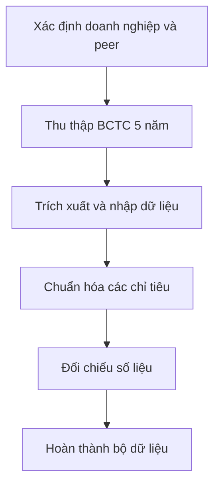
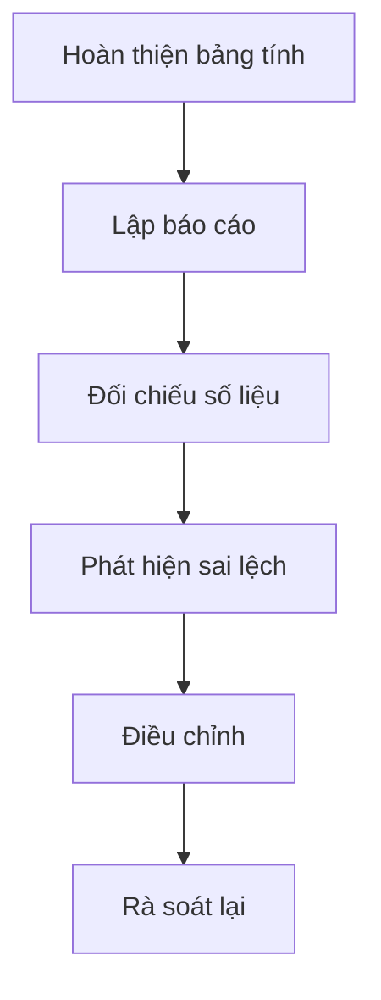
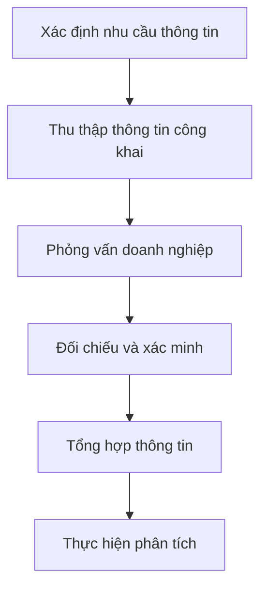

# Báo cáo cá nhân — MSSV_HoTen

> Đổi tên file theo quy tắc `MSSV_HoTen.md`, ví dụ `20241234_NguyenVanAn.md` (MSSV trước, dấu `_`, họ tên viết liền không dấu). Sửa cả dòng tiêu đề phía trên cho khớp.
> Template chi tiết và prompt mẫu cho từng mục: [docs/01-worksheet.md](../../docs/01-worksheet.md).
> Mỗi thành viên một file trong `report/individual/` trên repo nhóm: copy template này thành file mới, điền, rồi commit bằng tài khoản GitHub của bạn. Không viết hộ người khác.

## 1. Thông tin học viên

- Họ tên: Lê Hoàng Quân
- MSSV: 2A202603369
- Email trường (không bắt buộc, repo có thể để public):
- Tên nhóm: ngocquantruonganh
- Link repo nhóm: https://github.com/Dovanngoc05/K5-L3A-Day02-ngocquantruonganh-DiscoveryProblemFraming/tree/main/report

---

## 2. Scan problem (CP1)

Lăng kính: **Lặp lại** · **Tốn thời gian** · **Cần đọc, tổng hợp nhiều thông tin** · **Pain từ người khác**.

| # | Lăng kính | Job Story: Khi... tôi muốn... để... | Ai chịu ảnh hưởng? | Dấu hiệu thật (thời gian, tần suất, số người, bằng chứng) |
|---:|---|---|---|---|
| 1 | Lặp lại | Khi phân tích tín nhiệm lần đầu cũng như định kỳ, tôi phải thu thập và chuẩn hóa BCTC từ nhiều doanh nghiệp, để bảo đảm dữ liệu đầu vào nhất quán. | Chuyên viên phân tích tín nhiệm | BCTC 5 năm gần nhất của doanh nghiệp và peer, tầm 1 - 2 ngày để nhập tay |
| 2 | Tốn thời gian | Khi lập báo cáo xếp hạng tín nhiệm, tôi muốn đối chiếu số liệu giữa BCTC, Excel và báo cáo phân tích, để hạn chế sai lệch. | Chuyên viên phân tích và người rà soát | Mất từ 1 đến 3 tiếng, tùy độ phức tạp |
| 3 | Cần đọc, tổng hợp nhiều thông tin | Khi đánh giá một doanh nghiệp, tôi muốn tổng hợp thông tin từ nhiều nguồn, để có đủ căn cứ đưa ra nhận định tín nhiệm. | Chuyên viên phân tích tín nhiệm | Từ nhiều nguồn: website doanh nghiệp, Google search, phỏng vấn doanh nghiệp, tốn từ 1 đến 2 ngày |
| 4 | Lặp lại | Khi viết báo cáo lần đầu cũng như cập nhật báo cáo định kỳ, tôi muốn cập nhật biểu đồ và nhóm doanh nghiệp so sánh, để kết quả phân tích phản ánh dữ liệu mới nhất. | Chuyên viên phân tích | Khoảng 20 biểu đồ và từ 1 đến 2 ngày làm việc |
| 5 | Pain từ người khác | Khi rà soát báo cáo tín nhiệm, tôi muốn kiểm tra tính nhất quán giữa nhận định và số liệu, để giảm số vòng chỉnh sửa. | Người kiểm soát chất lượng báo cáo | Cần 3-4 người rà soát, các lỗi về chính tả, logic, mức độ bám sát phương pháp luận, tính xác thực của thông tin |
| 6 | Cần đọc, tổng hợp nhiều thông tin | Khi giám sát rủi ro tín dụng, tôi muốn nhận diện sớm biến động chất lượng tài sản và thanh khoản, để kịp thời đánh giá rủi ro. | Chuyên viên quản trị rủi ro | 3 tháng một lần tôi phải đánh giá các thay đổi về vĩ mô, ngành và doanh nghiệp, ví dụ những biến động về lãi suất, tác động rất lớn đến ngành Bất động sản và doanh nghiệp như Vinhomes |
| 7 | Pain từ người khác | Khi người sử dụng đọc báo cáo, tôi muốn họ truy xuất được nguồn số liệu quan trọng, để thuận tiện kiểm tra và xác minh kết luận. | Người sử dụng và người rà soát báo cáo | Khách hàng có thể đọc báo cáo và phản hồi hoặc thắc mắc về dữ liệu, phương pháp luận|

---

## 3. Top 3 Problem Cards + quy trình nháp (CP2)

### Bảng chọn top 3

| Rank | Problem | Vì sao chọn | Điều còn chưa chắc |
|---:|---|---|---|
| 1 | Thu thập và chuẩn hóa BCTC của doanh nghiệp và peer | Quy trình lặp lại ở mỗi kỳ phân tích; thời gian nhập thủ công khoảng 1–2 ngày; có thể đo hiệu quả cải thiện | Khả năng chuẩn hóa BCTC khác mẫu, mức độ đầy đủ và độ tin cậy của dữ liệu nguồn |
| 2 | Đối chiếu số liệu giữa BCTC, Excel và báo cáo phân tích | Tốn 1–3 giờ mỗi báo cáo; sai lệch số liệu có thể ảnh hưởng đến chất lượng phân tích tín nhiệm | Tỷ lệ sai sót thực tế, những sai lệch có thể phát hiện bằng quy tắc |
| 3 | Tổng hợp thông tin đa nguồn về doanh nghiệp | Tốn 1–2 ngày; liên quan trực tiếp đến việc thu thập bằng chứng cho nhận định tín nhiệm | Khả năng truy xuất nguồn, xác minh thông tin và xử lý dữ liệu không có cấu trúc |

### Problem Card #1

| Trường | Nội dung |
|---|---|
| Job Story | Khi thực hiện phân tích tín nhiệm lần đầu hoặc định kỳ, tôi muốn thu thập và chuẩn hóa BCTC 5 năm của doanh nghiệp và các peer, để bảo đảm dữ liệu đầu vào nhất quán, đầy đủ và có thể so sánh. |
| Actor | Chuyên viên phân tích tín nhiệm |
| Thời điểm / bối cảnh | Khi bắt đầu đánh giá tín nhiệm hoặc cập nhật báo cáo định kỳ |
| Quy trình hiện tại (3–7 bước) | Xác định doanh nghiệp và peer → Thu thập BCTC → Trích xuất và nhập số liệu → Chuẩn hóa chỉ tiêu → Kiểm tra dữ liệu → Tổng hợp dữ liệu phân tích |
| Bottleneck (bước nào, mất bao nhiêu phút) | Trích xuất, nhập và chuẩn hóa số liệu BCTC thủ công; tổng thời gian quy trình khoảng 1–2 ngày làm việc. Cần đo riêng thời gian của bước nghẽn. |
| Impact (nếu không giải thì sao) | Tốn nguồn lực phân tích, làm chậm tiến độ báo cáo; tăng rủi ro sai sót khi nhập liệu |
| Success metric (baseline → target) | Baseline: 1–2 ngày làm việc. Target đề xuất thử nghiệm: tối đa 4 giờ. Đo thời gian từ khi bắt đầu thu thập đến khi bộ dữ liệu được kiểm tra và chấp thuận. |
| Phương án không dùng AI | Chuẩn hóa biểu mẫu Excel, sử dụng Power Query hoặc công cụ trích xuất dữ liệu có cấu trúc |
| Giả thuyết về AI (nếu có) | AI có thể hỗ trợ trích xuất và ánh xạ chỉ tiêu từ BCTC có cấu trúc khác nhau; chuyên viên vẫn kiểm tra số liệu |
| Cảm nhận nhanh | Workflow – cần kiểm chứng xem Rule có đủ đáp ứng hay không |

Quy trình nháp hiện tại:

**Bottleneck dự kiến:** Trích xuất, nhập và chuẩn hóa dữ liệu thủ công.

**Thời gian:** Toàn bộ quy trình 1–2 ngày làm việc; cần bổ sung thời gian từng bước.

### Problem Card #2

| Trường | Nội dung |
|---|---|
| Job Story | Khi lập báo cáo xếp hạng tín nhiệm, tôi muốn đối chiếu số liệu giữa BCTC, Excel và báo cáo phân tích, để hạn chế sai lệch và bảo đảm chất lượng báo cáo. |
| Actor | Chuyên viên phân tích tín nhiệm và người rà soát báo cáo |
| Thời điểm / bối cảnh | Trong quá trình lập, rà soát và hoàn thiện báo cáo xếp hạng tín nhiệm |
| Quy trình hiện tại (3–7 bước) | Hoàn thiện bảng tính → Lập báo cáo → Đối chiếu số liệu → Phát hiện sai lệch → Điều chỉnh → Rà soát lại |
| Bottleneck (bước nào, mất bao nhiêu phút) | Đối chiếu thủ công giữa BCTC, Excel và báo cáo; tổng thời gian khoảng 1–3 giờ tùy độ phức tạp |
| Impact (nếu không giải thì sao) | Tăng thời gian rà soát và nguy cơ sử dụng số liệu không nhất quán trong báo cáo |
| Success metric (baseline → target) | Baseline: 1–3 giờ. Target đề xuất: tối đa 30 phút. Đo thời gian hoàn tất kiểm tra một báo cáo và số sai lệch còn lại sau rà soát. |
| Phương án không dùng AI | Sử dụng Excel, công thức đối chiếu và các quy tắc kiểm tra tự động |
| Giả thuyết về AI (nếu có) | AI hỗ trợ phát hiện những điểm không nhất quán giữa số liệu và nhận định bằng văn bản |
| Cảm nhận nhanh | Rule hoặc Workflow; cần xác định những sai lệch nào vượt khả năng kiểm tra bằng quy tắc |

Quy trình nháp hiện tại:

**Bottleneck dự kiến:** Đối chiếu và phát hiện sai lệch thủ công.

**Thời gian:** 1–3 giờ cho toàn bộ việc đối chiếu; cần đo thời gian riêng của từng bước.

### Problem Card #3

| Trường | Nội dung |
|---|---|
| Job Story | Khi đánh giá tín nhiệm một doanh nghiệp, tôi muốn tổng hợp và xác minh thông tin từ nhiều nguồn, để có đủ căn cứ đưa ra nhận định tín nhiệm. |
| Actor | Chuyên viên phân tích tín nhiệm |
| Thời điểm / bối cảnh | Khi phân tích hồ sơ doanh nghiệp và lập báo cáo tín nhiệm |
| Quy trình hiện tại (3–7 bước) | Xác định nhu cầu thông tin → Thu thập thông tin từ website và nguồn công khai → Phỏng vấn doanh nghiệp → Đối chiếu và xác minh → Tổng hợp → Phân tích |
| Bottleneck (bước nào, mất bao nhiêu phút) | Thu thập, đối chiếu và tổng hợp thông tin từ các nguồn khác nhau; tổng thời gian khoảng 1–2 ngày |
| Impact (nếu không giải thì sao) | Kéo dài thời gian phân tích và có nguy cơ bỏ sót thông tin quan trọng |
| Success metric (baseline → target) | Baseline: 1–2 ngày. Target đề xuất: tối đa 4 giờ cho phần tổng hợp thông tin đã có sẵn; không tính thời gian chờ phỏng vấn. Đo thời gian thực hiện và tỷ lệ thông tin quan trọng có nguồn xác minh. |
| Phương án không dùng AI | Xây dựng checklist thông tin, biểu mẫu phỏng vấn và cơ sở dữ liệu nguồn |
| Giả thuyết về AI (nếu có) | AI hỗ trợ tìm kiếm, phân loại và tóm tắt tài liệu có dẫn nguồn; chuyên viên xác minh và tự đưa ra nhận định |
| Cảm nhận nhanh | Workflow; chưa có căn cứ để lựa chọn Agent |

Quy trình nháp hiện tại:

**Bottleneck dự kiến:** Thu thập và tổng hợp thông tin từ nhiều nguồn.

**Thời gian:** 1–2 ngày cho quy trình; cần tách thời gian làm việc thực tế khỏi thời gian chờ thông tin.

### Card muốn pitch nhất

- Card số:
- Vì sao:
- Câu hỏi muốn nhóm phản biện:

### AI đã phản biện card thế nào

| Điểm yếu AI chỉ ra | Đồng ý? | Đã sửa gì |
|---|---|---|
| | | |

---

## 4. Tôi đã tham gia phần nào (CP3 → CP7)

| Hoạt động | Tôi đã làm gì? | Kết quả / ảnh hưởng tới bài nhóm |
|---|---|---|
| Pitch Problem Card | | |
| Phản biện bài của bạn khác | Câu hỏi tôi đã đặt: | |
| Nhận phản biện | Câu hỏi tôi nhận được: | Tôi đã sửa gì: |
| Gom cluster / cây OST | | |
| Chọn candidate problem | | |
| Kiểm chứng / research | | |
| Quy trình nhóm | | |
| Problem Statement | | |
| Mức can thiệp AI | | |
| Quyết định | | |

---

## 5. Dùng AI

| Checkpoint | Tôi dùng AI để làm gì? | AI hữu ích ở đâu? | AI sai hoặc hời hợt ở đâu? | Tôi sửa gì bằng nhận định của mình? |
|---|---|---|---|---|
| CP1 Scan | | | | |
| CP2 Problem Card | | | | |
| CP4 Research | | | | |
| CP5 Quy trình | | | | |
| CP5–6 Problem Statement | | | | |
| CP6 Mức can thiệp / quyết định | | | | |

---

## 6. Reflection (CP7)

Trả lời bằng trải nghiệm thật của bạn, tối thiểu 200 từ cho các câu 6.1–6.6 (không tính 6.7, câu này được chấm riêng ở tiêu chí C5). **Không dùng AI để viết thay.**

**6.1. Tôi học được gì khi nghe top 3 problems của các bạn khác?**

**6.2. Nhóm có lúc nào bị "solution-first" (nghĩ giải pháp trước khi hiểu vấn đề) không? Lúc đó nhóm nhận ra và xử lý thế nào?**

**6.3. Tôi có đổi ý sau khi bị phản biện không? Kể một lần cụ thể.**

**6.4. Kết quả kiểm chứng (phỏng vấn/survey/research) có làm tôi bất ngờ không? Điều gì?**

**6.5. Điều khó nhất khi viết Problem Statement là gì?**

**6.6. Nếu làm lại, tôi sẽ đổi gì? Tôi sẽ phản biện nhóm mạnh hơn ở điểm nào?**

**6.7. Hiểu bài:** giải thích bằng 5–8 câu, không nhìn tài liệu, chuỗi *problem → quy trình → metric → boundary → mức can thiệp AI → quyết định* của bài nhóm mình.

---

## 7. Tài liệu tham khảo

-
