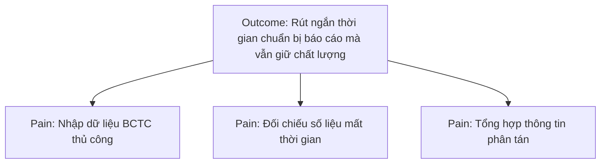
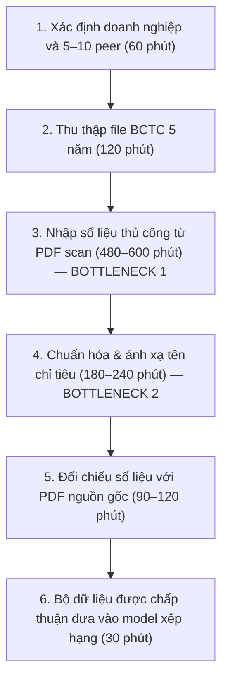
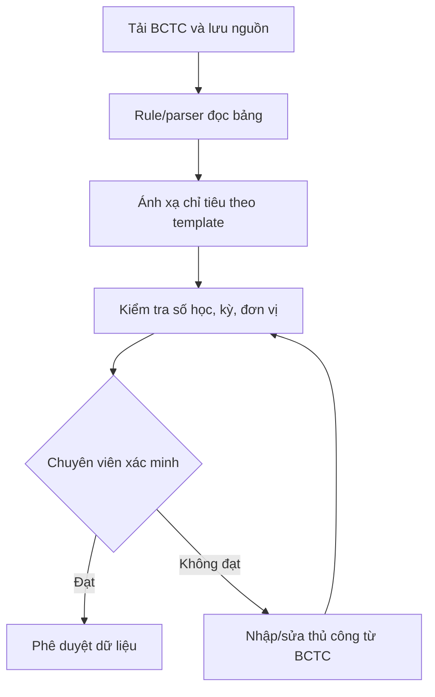

# Báo cáo nhóm — Day 02 Discovery & Problem Framing

> **BẢN LÀM VIỆC CHỜ NHÓM XÁC NHẬN.** Nội dung về quy trình và giải pháp bên dưới là các gợi ý để nhóm tự kiểm tra, không phải kết quả phỏng vấn, thử nghiệm hay quyết định đã được xác minh. Theo RULES.md, AI chỉ hỗ trợ phản biện Problem Statement và quyết định; nhóm cần tự viết/chốt các phần này sau thảo luận.

## 1. Thông tin nhóm

- **Tên nhóm:** ngocquantruonganh (L3A)
- **Thành viên:** xem `TEAM.md` (chưa có danh sách xác nhận trong tài liệu cung cấp)
- **Candidate problem được chọn:** Thu thập, nhập và chuẩn hóa dữ liệu báo cáo tài chính (BCTC) 5 năm của doanh nghiệp cần xếp hạng và 5–10 doanh nghiệp so sánh (peer) đang tốn nhiều thời gian nhập liệu thủ công.
- **Cơ sở lựa chọn:** Anh Lê Hoàng Quân cho biết cả nhóm nhất trí với đề xuất trong báo cáo cá nhân của anh. **Nhóm cần xác nhận lại** biên bản pitch, các candidate của thành viên khác, chấm điểm và phạm vi đề tài cuối cùng.
- **Quyết định cuối:** *Chưa chốt — cần hoàn thành CP4–CP6.*

---

## 2. Hội tụ nhóm (CP3)

### 2.1. Pitch

| # | Người đưa ra | Candidate (Job Story ngắn) | Actor | Bottleneck | Câu hỏi phản biện nhận được (ai hỏi) |
|---:|---|---|---|---|---|
| 1 | Lê Hoàng Quân | Khi phân tích tín nhiệm, tôi muốn có bộ BCTC 5 năm đã chuẩn hóa của doanh nghiệp và peer để phân tích nhất quán | Chuyên viên phân tích tín nhiệm | Nhập số liệu thủ công; toàn quy trình khoảng 1–2 ngày | Vì sao cần thu thập BCTC trong 5 năm và dữ liệu của các doanh nghiệp peer? Thời gian 1–2 ngày chủ yếu nằm ở bước thu thập, nhập liệu hay chuẩn hóa số liệu? người hỏi: Đoàn Nhật Anh |
| 2 | Lê Hoàng Quân | Khi lập báo cáo, tôi muốn đối chiếu dữ liệu giữa BCTC, Excel và nội dung báo cáo để giảm sai lệch | Chuyên viên và người rà soát | Đối chiếu thủ công 1–3 giờ | Sai lệch thường xuất hiện ở những loại dữ liệu nào? Việc đối chiếu mất 1–3 giờ có thường xuyên xảy ra không, và nguyên nhân chính là do nhập liệu sai hay do dữ liệu giữa các nguồn không thống nhất? Người hỏi: Đoàn Nhật Anh |
| 3 | Lê Hoàng Quân | Khi đánh giá doanh nghiệp, tôi muốn tổng hợp thông tin từ các nguồn khác nhau để có căn cứ nhận định | Chuyên viên phân tích | Tổng hợp nhiều nguồn 1–2 ngày | **[Ghi câu hỏi thực tế]** |
| 4 | Nguyễn Thế Trường | Khi đến hạn nộp bài lab hàng tuần, tôi muốn đối chiếu toàn bộ checklist và cấu trúc file nộp, để không bị trừ điểm vì lỗi format ngớ ngẩn | Sinh viên thực hành lab | Rà soát thủ công từng file và mục báo cáo markdown (20–25 phút) | *"Nếu chỉ kiểm tra tên file và định dạng thì viết script regex/linter là xong, việc gì phải dùng AI?"* (Lê Hoàng Quân hỏi) |
| 5 | Nguyễn Thế Trường | Khi ôn tập thi cuối kỳ, tôi muốn gom các câu hỏi và giải đáp của GV/TA trên Discord/Zalo, để ôn tập đúng trọng tâm mà không phải lội tin nhắn | Sinh viên chuẩn bị thi | Cuộn tìm tin nhắn và ghép cặp câu hỏi - lời giải đáp (60–75 phút) | *"Tin nhắn chat sinh viên viết tắt và ngắt quãng nhiều thì làm sao gom đúng ngữ cảnh?"* (Đỗ Văn Ngọc hỏi) |
| 6 | Nguyễn Thế Trường | Khi thực hành AI mới, tôi muốn tự động sửa các lỗi xung đột giữa PyTorch, CUDA và NVIDIA driver, để chạy code mẫu không mất cả buổi | Sinh viên học AI/Deep Learning | Tìm cách fix trên StackOverflow và gỡ cài lại nhiều lần (35–45 phút) | *"Mỗi máy một cấu hình card và OS khác nhau, tra cứu rule matrix có đủ không hay cần AI?"* (Đoàn Nhật Ánh hỏi) |
| 4–12 | **[Các thành viên khác điền]** | **[Candidate đã pitch]** | | | |

### 2.2. Cluster

| Cluster đề xuất để nhóm xem xét | Các candidate | Pattern chung |
|---|---|---|
| A — Chuẩn bị dữ liệu | Nhập, chuẩn hóa BCTC và peer. Sửa các lỗi xung đột giữa Pytorch, CUDA và NVIDIA driver | Dữ liệu phân tán, nhiều thao tác thủ công |
| B — Kiểm soát chất lượng | Đối chiếu số liệu giữa các nguồn và báo cáo. Đối chiếu toàn bộ checklist và cấu trúc file nộp | Cần phát hiện sai lệch, bảo đảm nhất quán |
| C — Tổng hợp bằng chứng | Thu thập, xác minh thông tin đa nguồn. gom các câu hỏi và giải đáp của GV/TA trên Discord/Zalo, để ôn tập đúng trọng tâm mà không phải lội tin nhắn | Nhiều nguồn thông tin và công đoạn xác minh |

### 2.3. Opportunity Solution Tree rút gọn

Những ý là *solution* cần tách khỏi opportunity: “xây chatbot”, “làm AI Agent”, “dùng OCR” hoặc “viết chương trình Python”. Đây là phương án giải quyết, không phải vấn đề của người dùng.

### 2.4. Chấm điểm shortlist (1–5)

> **Nhóm tự chấm và ghi lý do; không sử dụng điểm do AI suy đoán.**

| Candidate | Actor rõ | Quy trình rõ | Pain có bằng chứng | Impact đo được | Vừa sức lab | So sánh được 4 mức | Nhóm hiểu domain | Tổng |
|---|---:|---:|---:|---:|---:|---:|---:|---:|
| Nhập và chuẩn hóa BCTC | [ ] | [ ] | [ ] | [ ] | [ ] | [ ] | [ ] | [ ] |
| Đối chiếu số liệu | [ ] | [ ] | [ ] | [ ] | [ ] | [ ] | [ ] | [ ] |
| Tổng hợp thông tin đa nguồn | [ ] | [ ] | [ ] | [ ] | [ ] | [ ] | [ ] | [ ] |
| Kiểm tra checklist & cấu trúc bài lab (Trường) | [ ] | [ ] | [ ] | [ ] | [ ] | [ ] | [ ] | [ ] |
| Gom câu hỏi & giải đáp trên Discord/Zalo (Trường) | [ ] | [ ] | [ ] | [ ] | [ ] | [ ] | [ ] | [ ] |
| Tự động sửa lỗi xung đột CUDA/PyTorch (Trường) | [ ] | [ ] | [ ] | [ ] | [ ] | [ ] | [ ] | [ ] |

**Candidate được chọn theo thông tin anh Quân cung cấp:** Nhập và chuẩn hóa BCTC của doanh nghiệp và peer.

**Lý do đề xuất:** Công việc lặp lại; bottleneck nhập tay rõ; baseline tự báo cáo khoảng 1–2 ngày; có thể đo thời gian và sai lệch trên một bộ dữ liệu mẫu. **Cần nhóm xác nhận cách chấm và lý do loại ít nhất hai candidate còn lại.**

**Xử lý bất đồng:** [Nhóm ghi trung thực; nếu không có bất đồng, ghi rõ cách đạt đồng thuận.]

---

## 3. Kiểm chứng + research giải pháp đã có (CP4)

### 3.1. Assumption Map — danh sách giả định để kiểm chứng

| # | Giả định cần kiểm chứng | Loại | Quan trọng (1–5) | Đã có bằng chứng (1–5) | Kiểm chứng trước? |
|---:|---|---|---:|---:|---|
| 1 | Nhập BCTC là công đoạn tốn thời gian nhất | Value | 5 | 5 | Có |
| 2 | Quy trình có thể rút ngắn mà vẫn giữ độ chính xác | Value | 5 | 3 | Có |
| 3 | BCTC của doanh nghiệp và 5–10 peer có thể thu thập hợp lệ, đủ 5 năm | Feasibility | 5 | 5 | Có |
| 4 | Một bộ ánh xạ chỉ tiêu có thể xử lý sự khác nhau giữa ngành và biểu mẫu | Feasibility | 4 | 4 | Có |
| 5 | Chuyên viên có thể rà soát và sửa lỗi từ hệ thống hỗ trợ | Usability | 5 | 5 | Có |
| 6 | Thời gian tiết kiệm lớn hơn chi phí triển khai, vận hành và kiểm soát | Viability | 5 | 3 | Có |
| 7 | Cần kết hợp Rule-based kiểm tra cân đối kế toán (Tổng TS = Nợ + VCSH) ngay sau khi AI trích xuất để phát hiện sai lệch số liệu | Feasibility | 5 | 3 | Có (Trường bổ sung) |

### 3.2. Kiểm chứng bằng người thật

**Tình trạng:** Chưa có phỏng vấn/survey được cung cấp. Nhóm phải tự phỏng vấn 2–3 người phù hợp hoặc làm micro-survey 5–10 người; không dùng AI giả lập người trả lời.

Các câu hỏi tham khảo theo *The Mom Test*:

1. Trong lần gần nhất xử lý dữ liệu BCTC, anh/chị đã thực hiện những bước nào?
2. Bước nào mất nhiều thời gian nhất? Có thể nhớ một ví dụ gần đây không?
3. Khi phát hiện dữ liệu không khớp, anh/chị xử lý ra sao?
4. Những công cụ hiện tại đã hỗ trợ được phần nào? Phần nào vẫn phải làm thủ công?

| Người được hỏi (vai trò, không ghi tên) | Thời điểm, phương pháp | Hành vi thực tế và thời gian | Workaround | Tín hiệu xác nhận | Tín hiệu phản bác |
|---|---|---|---|---|---|
| [Người 1] | Nhập dữ liệu thủ công | 1-2 ngày |  |  Kết quả cải thiện khi dùng | Xác nhận đúng |
| Chuyên viên phân tích tín dụng KHDN |  phỏng vấn trực tiếp (25 phút) | Thẩm định hồ sơ BCTC scan 5 năm của công ty xây dựng và 5 peer; mất gần 12 tiếng gõ và chuẩn hóa số liệu vào mẫu nội bộ. | Giao thực tập sinh nhập liệu; mở 2 màn hình để soi PDF đối chiếu bảng tính; viết hàm SUM kiểm tra đối ứng. | Khâu nhập liệu và chuẩn hóa tên gọi chỉ tiêu BCTC chiếm 60–70% tổng thời gian xử lý hồ sơ. | Không dám dùng số liệu nếu công cụ AI trích xuất không có Bounding Box highlight đối soát trực tiếp trên file PDF gốc. |
| Trưởng nhóm Thẩm định & Xếp hạng (Quỹ đầu tư) | 2 tuần trước, phỏng vấn qua Google Meet (30 phút) | Lập báo cáo xếp hạng 1 công ty sản xuất và 4 peer; mất 2 ngày làm việc cho khâu chuẩn bị và làm sạch dữ liệu. | Dùng template Excel nội bộ tích hợp các công thức kiểm tra logic kế toán cơ bản (Tổng TS = Tổng Nguồn vốn). | Chuẩn hóa dữ liệu thủ công 5 năm là điểm nghẽn lớn nhất làm chậm tiến độ trình Hội đồng rủi ro. | Các khoản mục phức tạp ở Thuyết minh BCTC bắt buộc chuyên viên phải tự phân loại, AI không được tự ý quyết định. |

**Nhóm đã sửa problem thế nào sau kiểm chứng:** Giữ lựa chọn bài toán BCTC nhưng thu hẹp phạm vi vào BCTC PDF scan của doanh nghiệp phi niêm yết / SME; bắt buộc bổ sung yêu cầu đối soát nguồn trên bản scan gốc và giữ ranh giới: AI chỉ trích xuất và cảnh báo cân đối, quyền quyết định phân loại cuối cùng thuộc về chuyên viên phân tích.

### 3.3. Research giải pháp đã có

> Dưới đây là **hướng nghiên cứu**, không phải kết quả research đã tự kiểm nguồn.

| Công cụ / pattern cần nghiên cứu | Link cần nhóm tự mở và kiểm | Bước có thể giải | Điểm cần thử | Khoảng trống cần kiểm chứng | Kết luận nghiên cứu |
|---|---|---|---|---|---|
| **Excel Power Query** | https://support.microsoft.com/vi-vn/office/nh%E1%BA%ADp-d%E1%BB%AF-li%E1%BB%87u-t%E1%BB%AB-t%E1%BA%ADp-tin-pdf-power-query-93b581e2-b05d-4a11-a8cf-ee4d093b13a8 (Kiểm tra ngày 09/11/2026) | Bước 3 & 4: Import bảng từ PDF số hóa dạng vector, làm sạch dữ liệu và tính toán đối ứng kế toán | Thử import tự động các file PDF có sẵn cấu trúc bảng tabular rõ ràng | Bất lực trước file scan dạng ảnh/dấu mộc mờ; gãy layout khi gặp ô gộp (merged cells); không hiểu ngữ nghĩa khi tên chỉ tiêu thay đổi | Chỉ phù hợp làm công cụ **Rule-based** kiểm tra logic và tính toán đối ứng sau khi đã có số liệu số hóa; không giải được bài toán trích xuất PDF scan |
| **Python (pandas & pdfplumber / camelot)** | https://github.com/jsvine/pdfplumber (Kiểm tra ngày 09/11/2026) | Bước 3 & 4: Bóc tách text, tọa độ bảng biểu và chạy các rule kiểm tra cân đối kế toán tự động | Thử viết script trích xuất bảng từ file PDF text-based và ánh xạ theo regex dictionary | Chi phí bảo trì regex/parser rất lớn vì mỗi công ty trình bày bảng một kiểu; dễ nhầm cột khi khoảng cách cell không đều | Giải quyết tốt khâu kiểm tra ràng buộc kế toán (Rule check), nhưng không đủ linh hoạt để xử lý sự đa dạng ngữ nghĩa của BCTC |
| **OCR & Document AI (LlamaParse / AWS Textract)** | https://llamaindex.ai/llamaparse (Kiểm tra ngày 09/11/2026) và https://aws.amazon.com/textract/ (Kiểm tra ngày 09/11/2026) | Bước 2, 3 & 4: OCR trích xuất bảng biểu từ ảnh scan, đọc hiểu ngữ cảnh và trả về Bounding Box tọa độ gốc | Thử parse các trang BCTC phức tạp có nhiều dòng gộp và ghi chú bên lề | Vẫn có rủi ro ảo giác (hallucination) ở con số nếu bản scan bị mờ; chi phí API; chưa tự động kiểm tra cân đối kế toán | **Mảnh ghép cốt lõi**: Cung cấp khả năng trích xuất bảng biểu và tọa độ Bounding Box để kết hợp với Rule kiểm tra và giao diện HITL duyệt |
---

## 4. Quy trình trước/sau (CP5) — GỢI Ý ĐỂ NHÓM TỰ KIỂM

### 4.1. Quy trình hiện tại (nháp)

| Bước | Actor | Input | Output | Thời gian / tần suất | Ghi chú & Điểm nghẽn |
|---:|---|---|---|---|---|
| **1** | Chuyên viên phân tích | Danh sách doanh nghiệp cần xếp hạng, mã ngành | Danh sách doanh nghiệp mục tiêu và 5–10 peer cùng ngành | 60 phút / hồ sơ | Lọc theo tiêu chí quy mô tài sản và lĩnh vực kinh doanh |
| **2** | Chuyên viên phân tích | Danh sách doanh nghiệp và peer | Thư mục chứa 30–50 file PDF/scan BCTC qua 5 năm | 120 phút / hồ sơ | Tải từ website doanh nghiệp, cổng thông tin hoặc nhận bản scan từ khách hàng |
| **3** | Chuyên viên phân tích | Các file PDF/scan BCTC 5 năm (nhiều bản scan mờ, nghiêng) | Bảng tính thô chứa toàn bộ số liệu 3 bảng chính (CĐKT, KQKD, LCTT) | **480–600 phút** (8–10 tiếng) | ⚠️ **BOTTLENECK CHÍNH 1:** Gõ tay từng số, dễ hoa mắt, nhầm lẫn số 0, lỗi lệch dòng do ô gộp (merged cells) |
| **4** | Chuyên viên phân tích | Bảng tính thô vừa nhập | Bộ chỉ tiêu tài chính đã ánh xạ theo biểu mẫu chuẩn nội bộ | **180–240 phút** (3–4 tiếng) | ⚠️ **BOTTLENECK 2:** Tên gọi chỉ tiêu giữa các DN không thống nhất; phải đọc thuyết minh để biết khoản mục thuộc chỉ tiêu nào |
| **5** | Chuyên viên / Người rà soát | Bảng dữ liệu chuẩn hóa và file BCTC PDF gốc | Danh sách sai lệch đã chỉnh sửa; bộ dữ liệu được phê duyệt | 90–120 phút (1.5–2 tiếng) | Mở song song 2 màn hình để soi từng con số; chạy công thức kiểm tra phương trình kế toán (Tài sản = Nguồn vốn) |
| **6** | Chuyên viên phân tích | Dữ liệu đã phê duyệt | Bộ dữ liệu sạch sẵn sàng nạp vào model chấm điểm tín nhiệm | 30 phút / hồ sơ | Lưu vết kiểm toán (audit trail) phục vụ giải trình nội bộ và Hội đồng thẩm định |

**Tổng kết Baseline hiện tại:**
- **Tổng thời gian quy trình:** Khoảng **960–1170 phút (tương đương 16–19.5 giờ làm việc, mất 1.5–2 ngày làm việc)** cho một hồ sơ thẩm định.
- **Tỷ lệ thủ công:** **6/6 bước (100% thủ công)**.
- **Bước nghẽn trọng tâm:** Bước 3 (Nhập số liệu thủ công) và Bước 4 (Chuẩn hóa chỉ tiêu) chiếm hơn **75% tổng thời gian** toàn bộ quy trình và là nguồn cơn phát sinh lỗi sai lệch số liệu.

### 4.2. Quy trình tương lai — hai phương án để đánh giá

| Bước | Actor / Thành phần | Phương thức xử lý | Input | Output | Thời gian ước tính |
|---:|---|---|---|---|---|
| **1** | Chuyên viên phân tích | **Thủ công** | Danh sách DN và peer | Thư mục file PDF scan đã lưu nguồn chuẩn | 30 phút |
| **2** | Document AI (LlamaParse/Textract) | **AI (Trích xuất)** | File PDF scan/ảnh | Dữ liệu bảng biểu dạng JSON kèm tọa độ Bounding Box từng ô | 5–10 phút |
| **3** | LLM Engine | **AI (Ánh xạ ngữ nghĩa)** | Dữ liệu bảng thô + Từ điển mẫu nội bộ | Bảng chỉ tiêu tài chính đã map vào mẫu chuẩn 5 năm | 5–10 phút |
| **4** | Rule Engine (Python/SQL) | **Rule (Kiểm soát cứng)** | Bảng chỉ tiêu tài chính vừa map | Báo cáo đối ứng: Kiểm tra cân đối kế toán (TS = Nợ + VCSH), gắn cờ cảnh báo | 2 phút |
| **5** | Chuyên viên phân tích | **Con người (HITL)** | Bảng dữ liệu + PDF gốc có highlight | Danh sách ô ngoại lệ được xác nhận; chỉnh sửa nếu AI nhận diện nhầm | 45–60 phút |
| **6** | Chuyên viên / Lãnh đạo | **Con người phê duyệt** | Dữ liệu đã sạch 100% | Bộ dữ liệu chính thức nạp vào hệ thống chấm điểm tín nhiệm | 15 phút |    

**Phương án A — Rule trước:** sử dụng dữ liệu có cấu trúc, Power Query/Python, bộ ánh xạ và đối chiếu số học; người dùng duyệt.

**Phương án B — Workflow có AI, nếu thử nghiệm A chưa đủ:** bước AI chỉ hỗ trợ trích xuất/đề xuất ánh xạ đối với tài liệu khó; hiển thị trang/dòng nguồn và mức tin cậy; không tự phê duyệt.

**Boundary đề xuất:** Không tự sửa BCTC nguồn, không tự suy diễn số liệu thiếu, không tự duyệt chỉ tiêu, không tự đưa ra bậc xếp hạng. Nếu lỗi hoặc thiếu nguồn, quay về quy trình nhập và đối chiếu thủ công.

### 4.3. Before / after — mục tiêu cần pilot

| Chỉ số | Trước | Sau (giả thuyết, chưa đo) | Cách kiểm |
|---|---|---|---|
| **Tổng thời gian** | 16–19.5 giờ (1–2 ngày làm việc) | 100–130 phút (mục tiêu ≤ 4 giờ) | Bấm giờ thực tế trên cùng một bộ hồ sơ mẫu (1 DN mục tiêu + 5 peer) |
| **Tỷ lệ chỉ tiêu đúng** | ~90–92% (hay sai sót do gõ nhầm số, sót dòng) | ≥ 98% (kết hợp AI OCR + Rule đối ứng kế toán chặn lỗi) | Đối chiếu chéo 100% chỉ tiêu với bản scan BCTC gốc qua Bounding Box |
| **Số bước thủ công** | 6/6 bước thủ công (100%) | 2/6 bước (chỉ còn khâu nạp file và chuyên viên rà soát duyệt) | Nhật ký thao tác (Audit log) của hệ thống |
| **Bottleneck** | Nhập số liệu tay (Bước 3) & Chuẩn hóa chỉ tiêu (Bước 4) | Chuyên viên rà soát ngoại lệ và đối soát Bounding Box (Bước 5) | Quan sát và đo thời gian thao tác của chuyên viên trong giai đoạn pilot (Điểm nghẽn mới chấp nhận được vì là khâu kiểm soát chất lượng) |
| **Rủi ro mới** | Sai sót nhập tay, hoa mắt khi gần deadline | AI ảo giác số liệu khi bản scan mờ; chuyên viên tự tin quá mức bỏ qua khâu kiểm | Kiểm tra tỷ lệ ngoại lệ bị Rule chặn lại; bắt buộc chuyên viên xác nhận Bounding Box trước khi bấm Approve |

---

## 5. Problem Statement v0 (CP5)

> **PHẦN NHÓM PHẢI TỰ VIẾT VÀ CHỐT.** Gợi ý kiểm tra đủ sáu trường; không dùng đoạn gợi ý của AI làm sản phẩm nộp nguyên trạng.

| Trường | Câu hỏi nhóm cần trả lời từ dữ liệu đã kiểm chứng |
|---|---|
| **Actor** | Ai trực tiếp nhập và kiểm tra BCTC? Ai duyệt dữ liệu cuối? |
| **Quy trình** | Phạm vi 5 năm và 5–10 peer có áp dụng cho một báo cáo cụ thể không? |
| **Bottleneck** | Bao nhiêu phút thực sự nằm ở khâu nhập tay, bao nhiêu ở tìm kiếm và chuẩn hóa? |
| **Impact** | Việc chậm/nhập sai đã tác động đến thời hạn và chất lượng ra sao? |
| **Success Metric** | Baseline được đo thế nào, target nào nhóm chấp nhận, có chỉ tiêu chất lượng đi kèm không? |
| **Boundary** | Dữ liệu nào không được tự suy đoán; ai chịu trách nhiệm kiểm tra và phê duyệt? |

**Problem Statement v0 do nhóm tự viết:**

> [Nhóm điền sau khi có CP4 và sơ đồ CP5 được xác nhận.]

**Phản biện đã nhận và cách sửa:** [Nhóm ghi thật.]

---

## 6. Mức can thiệp AI (CP6) — KHUNG PHẢN BIỆN

### 6.1. Ma trận độ mơ hồ × độ phức tạp

**Nhóm tự xác định ô:** [ ]

**Lập luận cần kiểm tra:** Bảng và chỉ tiêu đã chuẩn hóa có độ mơ hồ thấp hơn PDF scan hoặc biểu mẫu không đồng nhất; không nên gộp mọi nguồn thành một nhóm.

### 6.2. So sánh bốn mức

| Mức | Phương án cần đánh giá | Đủ khi nào | Rủi ro chính | Nhóm chọn? |
|---|---|---|---|---|
| No AI | Checklist, phân công và biểu mẫu chuẩn | Phần lớn trễ do tổ chức công việc | Vẫn nhập tay | [ ] |
| Rule | Power Query/Python, kiểm tra số học và ánh xạ cố định | BCTC có cấu trúc đủ ổn định | Rule dễ vỡ khi biểu mẫu đổi | [ ] |
| Workflow | Rule kết hợp AI cho trường hợp khó, người duyệt | Tài liệu đa dạng vượt khả năng parser | Trích sai chỉ tiêu | [ ] |
| Agent | AI tự chọn nhiều bước và công cụ | Chỉ khi quy trình thực sự biến động, không thể định trước | Khó kiểm soát, chi phí, audit trail | [ ] |

**Mức nhóm chọn:** [Tự chốt sau CP4–CP5]

**Vì sao mức đơn giản hơn không đủ:** [Nêu bằng chứng pilot; nếu Rule đủ, không cần AI Canvas/PAIR.]

### 6.3. AI Canvas rút gọn (chỉ điền nếu chọn Workflow/Agent)

| Thành phần | Câu hỏi cần nhóm trả lời |
|---|---|
| Prediction | AI tạo bảng/ánh xạ chỉ tiêu nào? |
| Judgment | Chuyên viên kiểm tra số liệu nào và theo quy tắc nào? |
| Action | Ai duyệt bộ dữ liệu cuối? |
| Outcome | Thời gian, tỷ lệ chính xác và độ đầy đủ đo thế nào? |
| Input | File BCTC và template có đủ, hợp lệ và được phép xử lý không? |
| Feedback | Những lỗi ánh xạ nào được ghi lại để sửa quy trình? |

### 6.4. Hai câu hỏi Google PAIR (nếu dùng AI)

- **Augment hay automate:** [Nhóm tự đánh giá người dùng muốn AI hỗ trợ hay tự làm; không tự suy đoán.]
- **Báo nhầm hay bỏ sót nguy hiểm hơn:** [Xác định bằng ví dụ nghiệp vụ thật và cơ chế kiểm tra.]

---

## 7. Problem Statement v1 + tiêu chí đánh giá (CP6)

> **Nhóm tự xây dựng v1 sau khi đối chiếu bằng chứng; AI chỉ dùng để chỉ ra điểm yếu.**

**Problem Statement v1:** [Nhóm điền đủ Actor, Quy trình, Bottleneck, Impact, Success Metric, Boundary, AI intervention point, Mức chọn, Rủi ro & người kiểm tra.]

| Trường | v0 | v1 | Vì sao đổi |
|---|---|---|---|
| [Nhóm chọn trường có thay đổi] | [ ] | [ ] | [Bằng chứng CP4–CP6] |

**Gợi ý thiết kế 3–5 tiêu chí eval để nhóm tự chốt:**

| # | Tiêu chí | Đạt khi | Không đạt khi |
|---:|---|---|---|
| 1 | Chính xác trị số | [Ngưỡng nhóm đo và xác nhận] | [Ngưỡng lỗi] |
| 2 | Đúng kỳ, loại báo cáo và đơn vị | [Kiểm tra được từ nguồn] | [Sai kỳ/đơn vị] |
| 3 | Truy xuất nguồn | [Có file, trang và vị trí số liệu] | [Không truy vết được] |
| 4 | Xử lý ngoại lệ | [Đưa người kiểm tra khi thiếu/không chắc] | [Tự suy đoán hoặc duyệt sai] |
| 5 | Thời gian xử lý | [Ngưỡng nhóm kiểm chứng] | [Vượt ngưỡng] |

---

## 8. Quyết định (CP6)

### 8.1. Bốn rủi ro

| Rủi ro | Câu hỏi | Mức độ Thấp / Trung bình / Cao | Lý do / bằng chứng |
|---|---|---|---|
| Value | Chuyên viên có thật sự cần cải thiện không? | [Nhóm chấm] | [Phỏng vấn/đo thời gian] |
| Usability | Người dùng có kiểm được và sửa được dữ liệu không? | [Nhóm chấm] | [Thử nghiệm với chuyên viên] |
| Feasibility | Có đủ dữ liệu và công cụ để xử lý đúng không? | [Nhóm chấm] | [Kết quả thử BCTC đại diện] |
| Viability | Phù hợp chi phí, bảo mật và vận hành không? | [Nhóm chấm] | [Ước tính chi phí, quyền dữ liệu] |

### 8.2. Kết luận

**Quyết định Go / Not Yet / No-Go:** [NHÓM TỰ CHỐT]

**Lý do dựa trên bằng chứng:** [ ]

**Nếu Go — pilot nhỏ nhất:** [Phạm vi, người phụ trách, dữ liệu, thời hạn]

**Nếu Not Yet — cần kiểm chứng:** [ ]

**Nếu No-Go — giải pháp thay AI:** [ ]

**Ngưỡng dừng có thể đo:** [Nếu sau X tuần, chỉ tiêu Y không đạt ngưỡng Z, quay về quy trình nào?]

---

## 9. Hạn chế và hướng tiếp theo

1. Thời gian 1–2 ngày hiện là dữ liệu từ kinh nghiệm cá nhân của anh Quân; cần xác minh bằng các hồ sơ và người dùng khác.
2. Chưa có kết quả phỏng vấn/survey và tín hiệu phản bác.
3. Chưa đo thời gian từng bước và chất lượng dữ liệu baseline.
4. Chưa so sánh công cụ hiện có bằng thử nghiệm thực tế; chưa đủ căn cứ chọn Rule/Workflow/Agent hoặc quyết định Go.
5. Nhóm cần hoàn thiện `TEAM.md` và lưu bằng chứng hợp lệ trong `report/assets/`.

## 10. Tài liệu tham khảo

- Báo cáo cá nhân `report/individual/2A202603369_LeHoangQuan.md` — kinh nghiệm và số liệu tự khai về quy trình phân tích tín nhiệm.
- `README.md`, `RULES.md`, `CHECKPOINTS.md`, `RUBRIC.md`, `docs/01-worksheet.md` của repository đề bài VinUni.
- [Nhóm bổ sung 2–3 đường dẫn research đã trực tiếp mở và kiểm nội dung, kèm ngày truy cập.]
